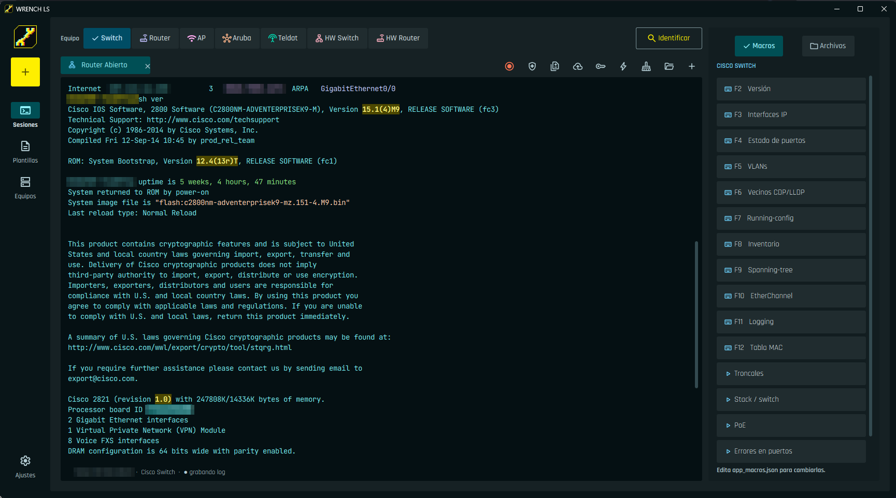
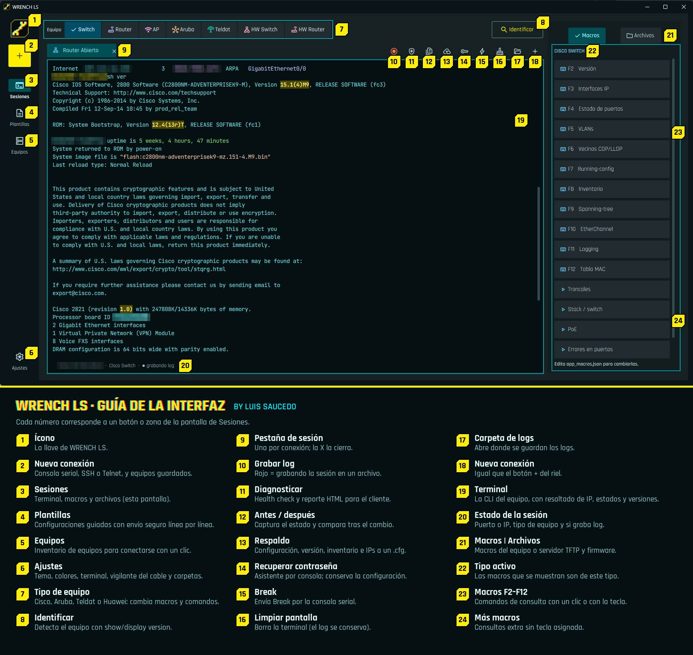

<p align="center">
  
</p>

<p align="center">
  <b>Consola para ingenieros de redes que viven en la CLI.</b><br>
  Cisco · Aruba · Huawei · Teldat — Windows 10/11 — beta gratuita
</p>

<p align="center">
  <a href="../../releases/latest"><b>⬇ Descargar la última versión</b></a> · <a href="https://www.virustotal.com/gui/file/928a6a644079a86e1a89a59d7c3525bb7e1e78803c38352ad69d559ed78f4804">🛡️ Análisis en VirusTotal</a>
</p>

---



## Qué hace

| | |
|---|---|
| 🔌 **Se abre sola** | Conectas el cable de consola y WRENCH abre la sesión en el puerto correcto. |
| 🖥️ **Serial, SSH y Telnet** | En pestañas, con resaltado de IPs, MACs, interfaces, up/down, err-disabled, logs y versiones. |
| ⌨️ **Macros F2–F12** | Comandos de consulta por tipo de equipo (Cisco switch/router/AP, Aruba, Huawei S/AR, Teldat). |
| 🩺 **Diagnóstico de salud** | Revisión de solo lectura (comandos show) con hallazgos, evidencia y reporte HTML para el cliente. |
| 📸 **Antes / después** | Captura el estado del equipo y lo compara tras el cambio: interfaces, VLANs, vecinos, rutas. |
| 💾 **Respaldo** | Configuración + versión + inventario + interfaces IP en un archivo, en un clic. |
| 📦 **TFTP y firmware** | Servidor TFTP integrado y asistente de actualización: Aruba, Catalyst 9000 en stack (INSTALL/BUNDLE, TFTP o USB) y Huawei. |
| 🔑 **Recuperación de contraseña** | Asistente por consola para Catalyst 9200/9300/9500, Catalyst clásico, ISR, Aruba AOS-S y Huawei. Conserva la configuración. |
| 🧩 **Plantillas** | Configuraciones guiadas con validación y envío seguro línea por línea. |

## Guía de la interfaz



## Instalación

1. Descarga `WRENCH-LS-Setup-<versión>.exe` desde [Releases](../../releases/latest).
2. Ejecútalo. No pide permisos de administrador: se instala solo para tu usuario.
3. Si Windows muestra **«Windows protegió su PC»**, haz clic en **Más información → Ejecutar de todas formas**.
   Aparece porque el instalador todavía no tiene firma digital.
4. Opcional: deja marcada la opción del vigilante para que WRENCH se abra al conectar un cable de consola.

Tus datos (logs, respaldos, capturas, reportes) quedan en `Documentos\WRENCH LS` y no se borran al desinstalar.

El instalador está analizado en [VirusTotal](https://www.virustotal.com/gui/file/928a6a644079a86e1a89a59d7c3525bb7e1e78803c38352ad69d559ed78f4804). Puedes comprobar que el archivo que descargaste
es el mismo con su SHA-256, publicado en cada Release:

```powershell
Get-FileHash .\WRENCH-LS-Setup-1.0.4-beta.exe -Algorithm SHA256
```

## Estado de la beta

- **Aruba AOS-S (2930F):** probado con equipos reales (consola, diagnóstico, firmware y recuperación de contraseña).
- **Cisco IOS / IOS-XE:** consola, Telnet y SSH probados con equipo real; además, en laboratorio GNS3 (IOS 15.9 e
  IOS-XE 17.18): macros, respaldo, antes/después, diagnóstico, plantillas, respaldo masivo, TFTP y Aplicar respaldo.
- **Marcado «experimental» en la app** (aún sin equipo real): recuperación de contraseña Cisco y Huawei, asistente
  de firmware Cisco y Huawei, Huawei VRP, Teldat, Cisco AP, respaldo masivo de Nexus/Huawei y Aplicar respaldo en NX-OS.

Úsala primero en laboratorio. Los asistentes que cambian algo en el equipo muestran los comandos y piden
confirmación antes de enviarlos. Si encuentras un error o quieres soporte para otro equipo, abre un
[Issue](../../issues) con el modelo, la versión y lo que pasó.

## Uso

WRENCH LS es gratuita para uso personal y profesional. Se distribuye tal cual, sin garantía: revisa siempre
lo que envías a un equipo en producción.

Fuentes incluidas: Rajdhani, JetBrains Mono y Google Sans Flex (SIL Open Font License 1.1) y
Material Symbols (Apache 2.0). Cisco, Aruba, Huawei y Teldat son marcas de sus respectivos dueños;
este proyecto no está afiliado a ninguno.

---

<p align="center"><i>Wake up, engineer. We have a network to fix.</i><br>— Luis Saucedo</p>
